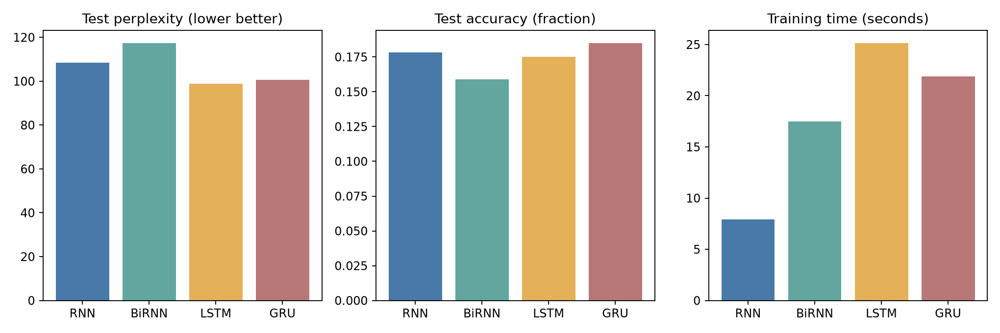
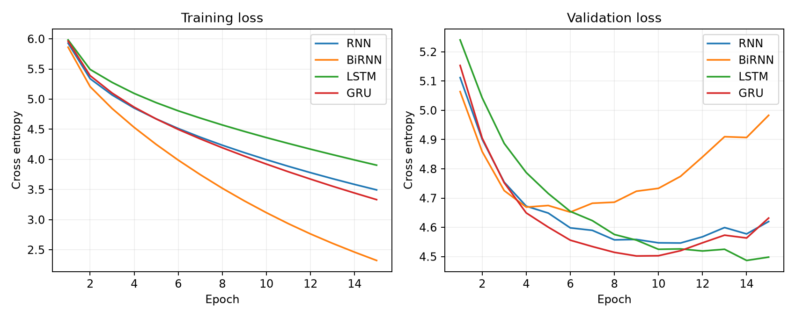
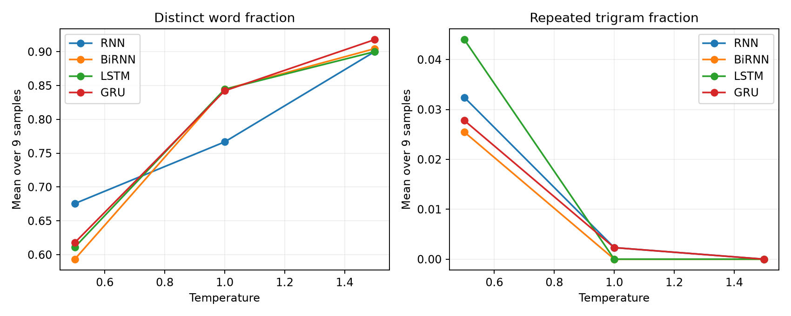

# Autoregressive text generation with RNN BiRNN LSTM and GRU

Foundations of Generative AI (ICT4403), Assignment 2

## Objective

Implement four recurrent neural networks under comparable experimental conditions, predict the next word from a past context, generate text autoregressively, and compare predictive quality, training cost and sampling behaviour.

**Main finding:** LSTM is the preferred model under the declared primary criterion of lowest held-out cross-entropy/perplexity. GRU achieves the highest next-word accuracy and is a reasonable speed/accuracy alternative. All models produce short locally plausible phrases but fail to sustain coherent 50-word narratives. These are measured results from a small, single-book experiment, not claims of general architectural superiority.

## Dataset and provenance

The dataset is Lewis Carroll's *Alice's Adventures in Wonderland*, downloaded from [Project Gutenberg ebook 11](https://www.gutenberg.org/ebooks/11). The [UTF-8 source](https://www.gutenberg.org/ebooks/11.txt.utf-8) is included unchanged in `data/alice.txt`, with its licence and notices. `data/SOURCE.md` documents provenance; `results/metadata.json` stores the original file hash.

The narrative contains 26,689 word tokens and 2,628 distinct word types after preprocessing. It is English literary prose with dialogue, recurring characters, narrative passages and verse. Its small size and changing vocabulary across chapters limit generalization. A single book offers consistent style, but is not representative of general English.

## Preprocessing and input construction

1. Remove the Gutenberg header/footer and table of contents; retain the narrative beginning at Chapter I. Chapter headings within the narrative remain.
2. Normalize curly apostrophes, lowercase, and tokenize with `[a-z]+(?:'[a-z]+)?`. Punctuation and numbers are discarded; contractions with internal apostrophes remain. The generated output therefore has no sentence punctuation.
3. Split the token stream chronologically into 80% train, 10% validation and 10% test **before making windows**. Token counts are 21,351 / 2,669 / 2,669. Adjacent windows overlap within each split, but no context window crosses a split boundary.
4. Build the vocabulary only from training words occurring at least twice. Map rare and unseen words to `<unk>`. The vocabulary has 1,293 entries including `<unk>`. Unknown-token rates are 4.84% / 11.73% / 12.85% for train/validation/test.
5. At every position form `X = [w(t-20), ..., w(t-1)]` and `y = w(t)`. This produces 21,331 training examples, 2,649 validation examples and 2,649 test examples. Targets are integer class indices; cross entropy consumes raw output logits.

The chronological split tests continuation into later parts of the book. It is more challenging than mixing random overlapping windows across splits. Metrics include `<unk>` targets, so they describe this reduced-vocabulary task; they are not full-vocabulary language-model scores. The relatively high held-out unknown rate is a material limitation.

## Models and fair comparison

All models use a learned 64-dimensional embedding, one recurrent layer, hidden size 96 per direction, and a linear vocabulary classifier. The final hidden state is used for next-word prediction.

- **Simple RNN:** a tanh recurrent state summarizes the past window. It is inexpensive but has no gates to regulate retention.
- **Bidirectional RNN:** two tanh RNNs encode the supplied past window in opposite directions; their final states are concatenated. The backward pass reverses only the already-observed 20 words. It never receives the target or future words, so generation remains autoregressive. This is a bidirectional context encoder, not a model trained with future-token access.
- **LSTM:** gates and a cell state regulate information retention and updating.
- **GRU:** reset and update gates regulate a single recurrent state.

Each model receives the same data, context length, batch size 128, Adam learning rate 0.001, gradient clipping norm 1.0, 15 epochs and seed 42. Initialization and shuffle generators are reset per model. The lowest-validation-loss checkpoint is selected independently, and only then evaluated on the held-out test split. There is no dropout, pretrained embedding, learning-rate search or early stopping. The full 15-epoch training cost is reported even when an earlier checkpoint wins.

Hidden size is controlled, but parameter counts differ, especially for BiRNN's doubled output width; this is not a parameter-matched comparison. The experiment used Python 3.12.5, PyTorch 2.14.1 and four CPU threads on macOS ARM64. Training time is wall-clock time for the epoch loop including validation and checkpoint writes, excluding preprocessing, sample generation and plots. Times will vary across machines.

## Quantitative evaluation

Mean test cross entropy is `L = -(1/N) sum(log p(y_i | X_i))`, using natural logarithms. Perplexity is `exp(L)`; lower is better. Accuracy is the fraction of targets equal to the highest-probability word; higher is better. These predictive metrics use the original logits (temperature 1.0) and include the unknown class. Temperature experiments separately measure sampled continuations.

| Model | Test loss | Perplexity | Accuracy | Training seconds | Selected epoch | Parameters |
|---|---:|---:|---:|---:|---:|---:|
| RNN | 4.6853 | 108.34 | 17.82% | 7.90 | 11 | 223,725 |
| BiRNN | 4.7653 | 117.37 | 15.89% | 17.50 | 6 | 363,405 |
| LSTM | 4.5939 | 98.88 | 17.52% | 25.14 | 14 | 270,381 |
| GRU | 4.6111 | 100.60 | 18.50% | 21.88 | 9 | 254,829 |



LSTM has the lowest test loss and perplexity, approximately 8.7% lower perplexity than Simple RNN. GRU's accuracy is 18.50%, versus 17.52% for LSTM, while its perplexity is slightly worse. This is possible because accuracy considers only the top-ranked prediction, whereas cross entropy scores the probability assigned to every correct target. LSTM therefore wins the primary distribution-quality criterion, not every metric.

BiRNN has the largest parameter count but the worst held-out perplexity. Reversing an already-observed short context did not improve this run. Extra capacity and limited data may contribute, but this experiment does not establish causality. Simple RNN trains fastest and remains a useful baseline.



Training losses continue declining after validation gains flatten. BiRNN's best epoch is 6, GRU's 9, Simple RNN's 11 and LSTM's 14. Later checkpoints can overfit, which is why checkpoint selection uses validation loss rather than the final epoch. Test data were not used to choose checkpoints.

## Autoregressive generation and temperature

For each step, encode the most recent 20 available words, obtain logits `z`, apply `softmax(z / T)`, sample one word, append it, and repeat. Seeds shorter than 20 words use their available context without invented padding. The hidden state is recomputed for the sliding window at every step. `<unk>` is masked during generation to avoid printing unknown placeholders; this renormalizes the distribution, and is distinct from unmasked evaluation.

The exact same three seeds are used for every model and temperature:

- `alice was beginning to get very tired`
- `the queen said to alice`
- `the rabbit took a watch out of`

Temperatures are **0.5, 1.0 and 1.5**. Each combination is sampled three times using random seeds 1000, 1001 and 1002, yielding 108 continuations of 50 words. Shared random seeds improve comparability but couple samples across conditions; these are not independent training runs. Short generation seeds also differ from the fixed 20-word training contexts, which is an additional limitation for the first generated words.

Diversity is measured by distinct-1 (unique words / generated words) and distinct-2 (unique bigrams / generated bigrams). Repetition is `1 - unique trigrams / total trigrams`, calculated per continuation. The table averages nine continuations per model/temperature (three prompts times three random seeds). Higher diversity alone does not mean better language: random word lists can score highly.

| Model | Temperature | Distinct-1 | Distinct-2 | Repeated trigram fraction |
|---|---:|---:|---:|---:|
| RNN | 0.5 | 0.676 | 0.909 | 0.032 |
| RNN | 1.0 | 0.767 | 0.971 | 0.002 |
| RNN | 1.5 | 0.900 | 0.993 | 0.000 |
| BiRNN | 0.5 | 0.593 | 0.889 | 0.025 |
| BiRNN | 1.0 | 0.844 | 0.995 | 0.000 |
| BiRNN | 1.5 | 0.904 | 0.995 | 0.000 |
| LSTM | 0.5 | 0.611 | 0.862 | 0.044 |
| LSTM | 1.0 | 0.844 | 0.993 | 0.000 |
| LSTM | 1.5 | 0.900 | 0.993 | 0.000 |
| GRU | 0.5 | 0.618 | 0.873 | 0.028 |
| GRU | 1.0 | 0.842 | 0.995 | 0.002 |
| GRU | 1.5 | 0.918 | 0.993 | 0.000 |



At **T = 0.5**, probability mass concentrates on familiar words and phrases. These continuations have more recognizable local syntax and character names, but more loops. For LSTM, distinct-1 is 0.611 and repeated-trigram fraction is 0.044. Its sample repeats “you won't” and “you join the dance.” GRU repeats “to herself”; Simple RNN repeats “of the house.” BiRNN shifts among the Dormouse, Gryphon and Cat without a stable event.

At **T = 1.0**, diversity increases and measured trigram repetition nearly disappears. However, strings such as “of i know what said its they question see” show weak grammar and coherence. Topic-related words remain, but their presence does not establish contextual consistency. The models do not reliably preserve the situation established by the prompt.

At **T = 1.5**, distributions flatten further. Distinct-1 reaches roughly 0.90-0.92 and repeated trigrams are absent in these short samples, but rare-word combinations and broken syntax dominate. This is lexical novelty rather than reliable creativity. Zero repeated trigrams does not exclude repeated individual words or semantic repetition.

For this small-data run, **T = 0.5 is the most defensible of the tested temperatures when readability matters**, while T = 1.0 or 1.5 increases novelty at a substantial coherence cost. No tested setting produces consistently coherent long text. Intermediate temperatures could be explored in a separate experiment, but were not measured here.

## Qualitative samples and assessment

The following are complete, unedited 50-word continuations for the first prompt, using random seed 1000. Full results for all prompts and repeats are in `results/generated_samples.csv` and `.json`. The observations are informal qualitative inspection, not blinded human ratings or a numeric semantic-coherence metric.

Prompt: **alice was beginning to get very tired**

### RNN at temperature 0.5

> of it and she tried to herself to see it is to me it and looked at the other of the house of the house and the queen was not a good deal frightened on the other side of the garden and she went on in the pool and the

### RNN at temperature 1.0

> of showing them had said its they had gone very lefthand tone and then a little majesty she walked up and filled of knot they marked out a low voice to play queen and in another idea oh of things mad she very eel up thought like they were knocking

### RNN at temperature 1.5

> always handed follow hold i'm its they had gone very lefthand tone underneath either a time majesty directly to my useful filled of knot they marked bear muttered it while cause shoulders am off in his idea oh of things mad she very eel cook thought like poison found knocking

### BiRNN at temperature 0.5

> of it was just as she could not see it had to her either and looked at the other and the dormouse of the house and the gryphon was a long tale and she was to the gryphon of the cat and she picked up and the mock turtle was

### BiRNN at temperature 1.0

> tea and held had made its they had see very lefthand tone and then a little majesty does to my the filled of isn't they marked on a few minutes cause shoulders else was in a few voice of things hours she very eel cook with like in queer knocking

### BiRNN at temperature 1.5

> ask i follow hold i'm good they think see yer lefthand tone underneath either a time majesty does to my useful filled of isn't they marked on fancy it them cause shoulders am off in his smiled oh of beginning mad what's very eel cook difficulty like keep queer knocking

### LSTM at temperature 0.5

> of it and was a good opportunity to see it had to me either you said the cat i wish you mean you won't you are you won't you won't you join the dance said the mock turtle who had not a very called but she had been to lie

### LSTM at temperature 1.0

> of i know what said its they question see very lonely tone and then he looked majesty the other of the dormouse of isn't never marked to fancy it while to shoulders am off in a few not of things mad she very called but she like keep queer as

### LSTM at temperature 1.5

> always came follow knowing said its they question see yer lefthand next underneath either a time majesty does to alice thought filled of isn't never marked fancy fancy it while to shoulders am off in his idea oh of things mad what's very called but thought there keep queer as

### GRU at temperature 0.5

> of it and she went on in the gryphon and the next thing as she could not be the march hare in the mouse of the sea thought alice she found herself to herself in a few minutes of broken and she tried to herself she had been to herself

### GRU at temperature 1.0

> of showing follow but i'm long they think i know longitude next me either to be majesty the other of the filled of isn't they marked on a low while cause and queen out of his eyes but of things mad she very eel cook with like a queer knocking

### GRU at temperature 1.5

> always and follow knowing said its they question see yer lefthand tone underneath either to chose majesty does to my useful filled of isn't they marked on fancy it while cause shoulders queen out somebody down would not of beginning mad with very eel cook thought like poison found knocking

## Conclusion and limitations

**LSTM is the selected model for this dataset and protocol because it achieves the lowest held-out cross entropy and perplexity.** Its low-temperature samples contain recognizable phrases and dialogue fragments, but also conspicuous repetition. GRU offers the highest top-1 accuracy and a lower measured training cost. The qualitative samples do not establish a clear semantic-quality winner, so the model selection is primarily quantitative. BiRNN's higher capacity does not help on this experiment.

The main limitations are one short book, a 20-word context, removal of punctuation, relatively high unknown-token rates, unequal parameter counts, one training random seed and a limited generation sample. There are no confidence intervals or significance claims. Further work could use multiple books, preserve punctuation, adopt subword tokenization, tune regularization on validation data, compare matched parameter budgets, and repeat training with several seeds. None of those improvements is claimed as completed.

## Run the project

Use Python 3.12 (the recorded run used 3.12.5). From this repository's root:

```bash
python -m venv .venv
# macOS/Linux:
source .venv/bin/activate
# Windows PowerShell instead: .venv\Scripts\Activate.ps1
python -m pip install -r requirements.txt
python train.py
python verify_results.py
python generate.py --model LSTM --temperature 0.5 --words 50
```

The dataset is bundled, so training needs no dataset download. Installation requires internet access. `requirements.txt` pins the three direct dependencies; `requirements-lock.txt` records the entire environment used. Saved checkpoints allow generation and verification without retraining. Training overwrites the recorded result artifacts; copy them first if you want to preserve this run. CPU-only execution is intentional for comparability. Different platforms/library builds may cause numerical or timing differences even with fixed seeds.

`python train.py --epochs 15 --seed 42` reproduces the configured experiment. To vary generation, set `--seed "the queen said to alice"`, `--temperature`, `--words` or `--random-seed` in `generate.py`.

## Files

```text
train.py                    Training, evaluation, sampling and plots
generate.py                 Inference using saved checkpoints
verify_results.py           Checkpoint and result consistency audit
requirements.txt            Pinned direct dependencies
requirements-lock.txt       Full recorded package environment
data/alice.txt              Original dataset with notices
data/SOURCE.md              Source and provenance
checkpoints/*.pt            Best-validation state dictionaries
results/metadata.json       Split counts, settings and dataset hash
results/vocabulary.json     Training-derived vocabulary
results/metrics.csv/json    Test results and runtime
results/history.csv         All 60 model-epoch records
results/generated_samples.* All 108 continuations
results/temperature_summary.json
results/*.png               Three comparison figures
```

Verification re-evaluated all four saved checkpoints and reproduced reported test metrics within tolerance. It also checks training-only vocabulary construction, 60 epoch records, unique sample conditions and 108 continuations of exactly 50 words. Inference was exercised independently using the saved LSTM checkpoint.

## References

- [Project Gutenberg, Alice's Adventures in Wonderland](https://www.gutenberg.org/ebooks/11)
- [PyTorch RNN documentation](https://docs.pytorch.org/docs/stable/generated/torch.nn.RNN.html)
- [PyTorch LSTM documentation](https://docs.pytorch.org/docs/stable/generated/torch.nn.LSTM.html)
- [PyTorch GRU documentation](https://docs.pytorch.org/docs/stable/generated/torch.nn.GRU.html)
